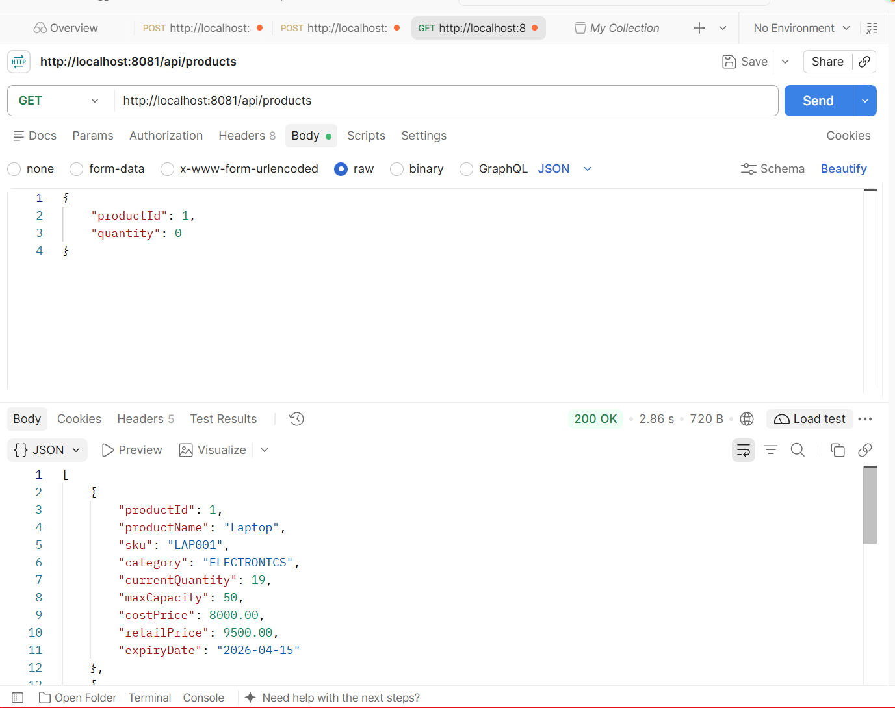
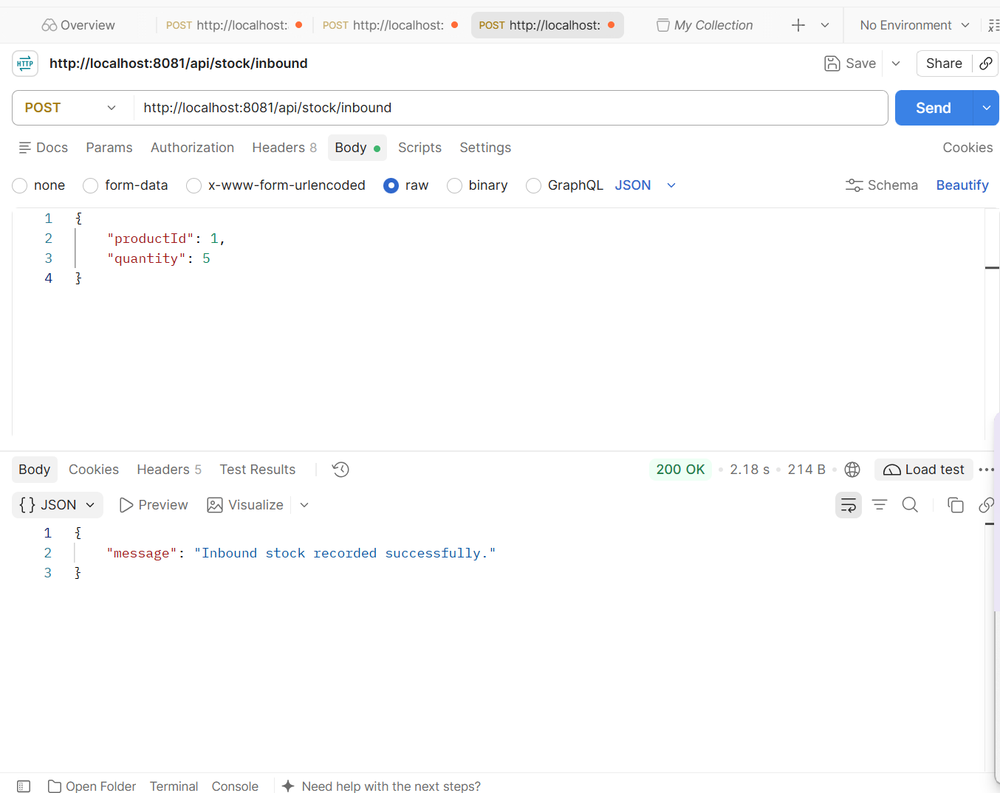
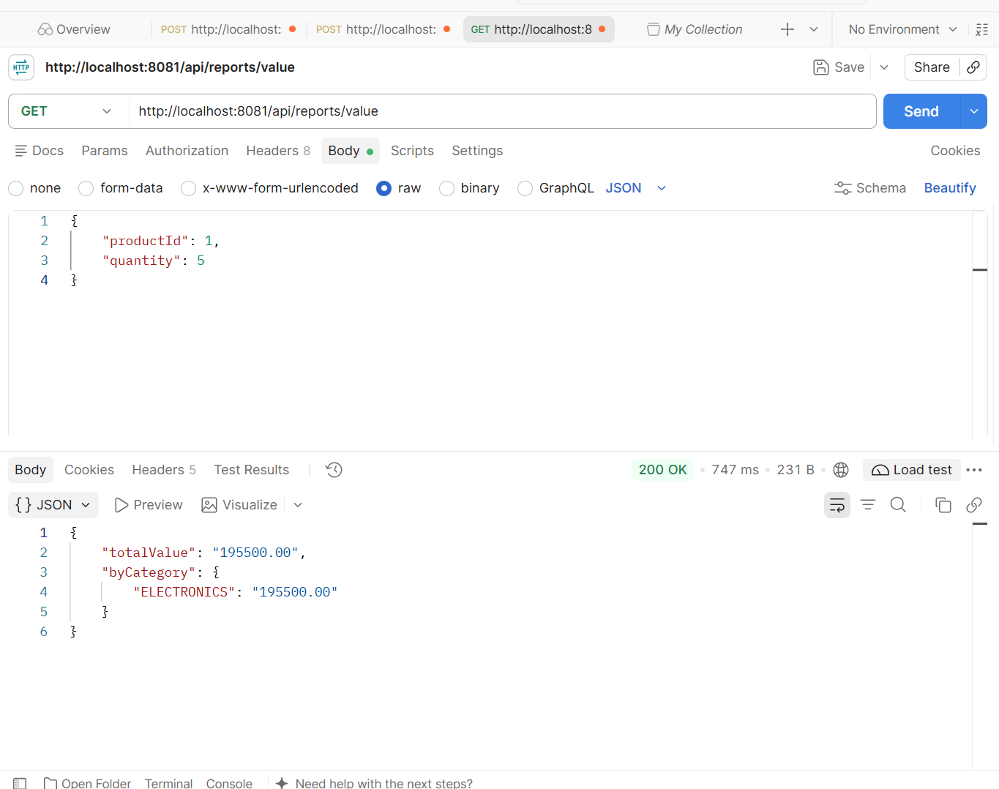
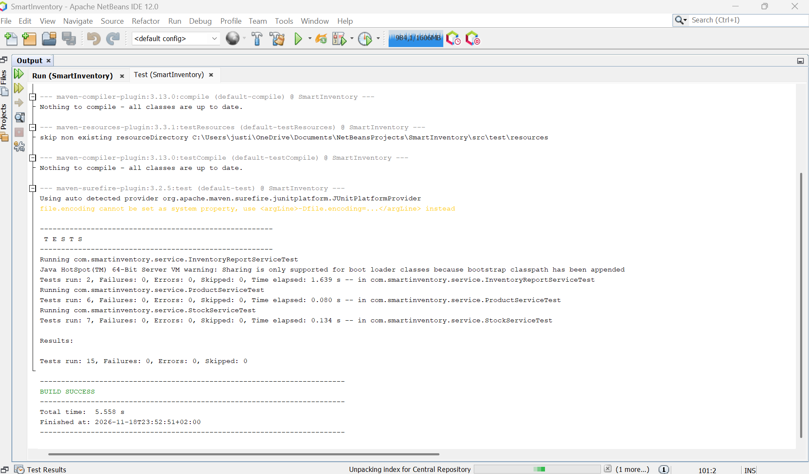

# SmartInventory

SmartInventory is a Java-based inventory management REST API developed using Spring Boot and MySQL.

The application helps manage products, monitor stock levels, record stock movements and generate inventory value reports.

This project was developed as part of my learning journey in Java backend development, with a focus on REST APIs, database integration and object-oriented programming.

## Technologies Used

- **Java 17** – Main programming language.
- **Spring Boot 3.3.5** – Backend application framework.
- **Spring Data JPA** – Database access and persistence.
- **MySQL** – Relational database.
- **Maven** – Project dependency and build management.
- **Hibernate** – Object-relational mapping.
- **JUnit 5** – Unit testing.
- **Mockito** – Mocking dependencies during unit tests.
- **NetBeans IDE** – Development environment.
- **Postman** – API testing.

## Main Features

- **Product Management:** Create, view, update and delete products.
- **Stock Management:** Record incoming and outgoing stock movements.
- **Stock Validation:** Prevent stock quantities from becoming negative or exceeding product capacity.
- **Low Stock Monitoring:** Identify products with stock quantities at or below the minimum threshold of 10.
- **Expiry Monitoring:** Retrieve products approaching their expiry dates.
- **Inventory Value Reports:** Calculate the total inventory value and display values grouped by category.
- **Input Validation:** Validate incoming API requests.
- **Exception Handling:** Return appropriate error responses when operations fail.
- **Unit Testing:** Test product management, stock management and inventory reporting services.

## API Endpoints

### Products

| Method | Endpoint | Description |
|---|---|---|
| POST | `/api/products` | Create a product |
| GET | `/api/products` | Retrieve all products |
| GET | `/api/products/{id}` | Retrieve a product by ID |
| PUT | `/api/products/{id}` | Update a product |
| DELETE | `/api/products/{id}` | Delete a product |
| GET | `/api/products/low-stock` | Retrieve products with low stock |
| GET | `/api/products/expiring-soon` | Retrieve products approaching expiry |

### Stock Management

| Method | Endpoint | Description |
|---|---|---|
| POST | `/api/stock/inbound` | Record incoming stock |
| POST | `/api/stock/outbound` | Record outgoing stock |

### Reports

| Method | Endpoint | Description |
|---|---|---|
| GET | `/api/reports/value` | Retrieve the inventory value report |

## Database Configuration

SmartInventory uses MySQL to store product information and stock movement records.

### 1. Create the database

Open MySQL and execute:

```sql
CREATE DATABASE smartinventory_db;
```

### 2. Configure database credentials

The application uses a separate `secrets.properties` file to store database credentials.

Create this file inside:

`src/main/resources/secrets.properties`

Add your own MySQL username and password:

```properties
spring.datasource.username=YOUR_MYSQL_USERNAME
spring.datasource.password=YOUR_MYSQL_PASSWORD
```

Replace the placeholders with your own MySQL credentials.

**Important:** The `secrets.properties` file is excluded from Git using `.gitignore`. Never upload your actual database credentials to GitHub.

## Running the Application

### Requirements

Before running SmartInventory, make sure you have installed:

- Java Development Kit (JDK) 17 or later.
- MySQL Server.
- Apache Maven.
- An IDE such as NetBeans or IntelliJ IDEA.

### Setup Instructions

1. Clone or download the SmartInventory repository from GitHub.
2. Create the MySQL database by running the `database/create_database.sql` script.
3. Create and configure `src/main/resources/secrets.properties` with your MySQL credentials.
4. Open the project in your preferred Java IDE.
5. Allow Maven to download the required dependencies.
6. Run the Spring Boot application.

The application runs on port `8081` by default.

Base API URL:

`http://localhost:8081/api`

### Running Unit Tests

To run the unit tests using Maven, execute:

```bash
mvn test
```

## Project Structure

## Project Structure

The project follows a layered structure to separate application responsibilities.

```text
src/
├── main/
│   ├── java/com/smartinventory/
│   │   ├── config/        # Application constants
│   │   ├── controller/    # REST API endpoints
│   │   ├── dto/           # Data transfer objects
│   │   ├── enums/         # Application enumerations
│   │   ├── exception/     # Custom exception handling
│   │   ├── model/         # JPA entity classes
│   │   ├── repository/    # Database access
│   │   └── service/       # Business logic
│   └── resources/         # Application configuration
└── test/
    └── java/              # Unit tests
```

## Author

Developed by **Justin Malesa** as a Java backend development portfolio project.

## Screenshots

### Product Management
Displays the products retrieved from the REST API.



### Stock Management
Shows a successful incoming stock movement.



### Inventory Value Report
Displays the total inventory value and category breakdown.



### Unit Tests
Shows the results of the automated unit tests.

